# 🏛️ DayBook Master Technical Blueprint: 5 Core Feature Modules & Global Architecture

**Role & Authority:** Senior Mobile Application Architect, Technical Product Manager, UI/UX Architect, and Software Engineering Lead  
**Target Environment:** Expo / React Native / TypeScript (iOS & Android) with Native Subsystems  
**Date:** November 2026 | **Version:** 2.0.0-PRO-BLUEPRINT  

---

# 📑 EXECUTIVE SUMMARY & ARCHITECTURAL MANIFESTO

This document serves as the implementation-ready, authoritative technical specification for integrating **FIVE independent, mission-critical feature modules** into the DayBook ecosystem. 

### Mandatory Technology Preservation Matrix
Every technology specified in the product directive is preserved with zero substitutions:

| Feature Module | Mandatory Preserved Technologies | Native Compilation Target |
| :--- | :--- | :--- |
| **01. Trip Countdown + Live Widgets** | `Expo`, `TypeScript`, `@bacons/apple-targets`, `SwiftUI`, `MMKV` | iOS Widget Extension (SwiftUI) & App Group Bridge |
| **02. Link Saver inside Share Sheet** | `Expo`, `TypeScript`, `expo-share-intent`, `Expo Router`, `expo-sqlite` | iOS Action/Share Extension & Android Intent Filter |
| **03. Habits You Finish from Notifications** | `Expo`, `TypeScript`, `expo-notifications`, `Zustand`, `MMKV` | Notification Categories, UNNotificationCenter, BroadcastReceiver |
| **04. NFC Tags that Run Routines** | `Expo`, `TypeScript`, `react-native-nfc-manager`, `expo-sqlite` | CoreNFC (iOS) & Android NFC Adapter foreground dispatch |
| **05. Heart Rate Monitor over Bluetooth** | `Expo`, `TypeScript`, `react-native-ble-plx`, `Reanimated` | CoreBluetooth (iOS) & Android Bluetooth Low Energy GATT Stack |

---

<!-- ========================================================================= -->
<!-- PAGE 01 -->
<!-- ========================================================================= -->
# PAGE 01 — TRIP COUNTDOWN WITH LIVE WIDGETS

```
       ┌────────────────────────────────────────────────────────┐
       │   PAGE 01: TRIP COUNTDOWN WITH LIVE WIDGETS             │
       │   Stack: Expo • TypeScript • @bacons/apple-targets     │
       │          SwiftUI • MMKV                                │
       └────────────────────────────────────────────────────────┘
```

## 1. Feature Overview
The Trip Countdown module brings travel milestones into the physical operating system surfaces of iOS and Android. Users register upcoming itineraries (flights, road trips, conferences), and the system projects real-time dynamic countdowns, route paths, and departure states directly onto the user's Home Screen and Lock Screen widgets using native SwiftUI and WidgetKit.

## 2. Problem Statement
Travel planning induces severe situational anxiety. Travelers constantly unlock their devices, open cluttered airline apps, or search through emails to verify departure hours, gate times, and time-zone conversions. Existing apps isolate this data inside closed walls. Users need zero-latency glanceability on ambient OS surfaces without launching the application.

## 3. Objectives
- Provide second-by-second countdown fidelity leading up to departure.
- Render glanceable route vectors (`DAC ➔ DXB ➔ LHR`) on lock and home screens.
- Synchronize app-configured trips to native widget memory within <100ms.
- Gracefully handle time-zone crossings, flight cancellations, and reschedules without stale widget states.

## 4. Complete Feature List
1. Multi-trip creation and lifecycle management (Active, Completed, Cancelled, Delayed).
2. Flight route parsing: origin/destination IATA codes, flight numbers, terminals, gates.
3. UTC-anchored real-time countdown calculation with departure and boarding offsets.
4. Home Screen widgets in three standard sizes: `systemSmall`, `systemMedium`, `systemLarge`.
5. Lock Screen widgets: `accessoryCircular`, `accessoryRectangular`, and `accessoryInline`.
6. Dynamic flight route visualization with progress arc on `systemMedium`.
7. Automatic timeline refresh triggering via WidgetKit `TimelineProvider`.
8. Multiple upcoming trip carousel and widget selector pinning.
9. Theme customization matching DayBook OLED black (`#000000`) and Lime Bold (`#B6FF00`).
10. Time-zone transformation engine computing local destination time vs. departure origin time.

## 5. Detailed User Journey
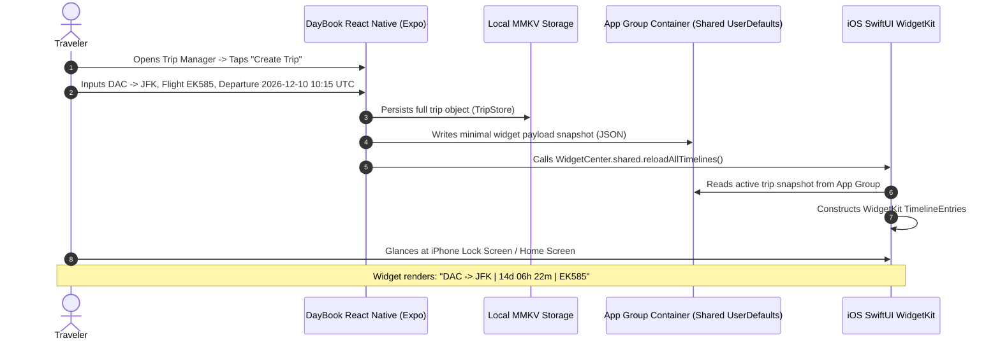

## 6. UI/UX Screen Structure
- **Screen 1.1: Trip Dashboard (`/trips`)**: Sticky header showing primary active trip with countdown timer, weather at destination, and list of upcoming secondary itineraries.
- **Screen 1.2: Trip Editor Modal (`/trips/edit/[id]`)**: High-contrast input form for Origin/Destination IATA codes, departure time picker, boarding buffer, flight number, and seat assignment.
- **Screen 1.3: Widget Configuration Preview (`/trips/widget-preview`)**: Interactive sandbox simulating `systemSmall`, `systemMedium`, and `accessoryRectangular` lock-screen layouts with OLED black previews.

## 7. Technical Architecture
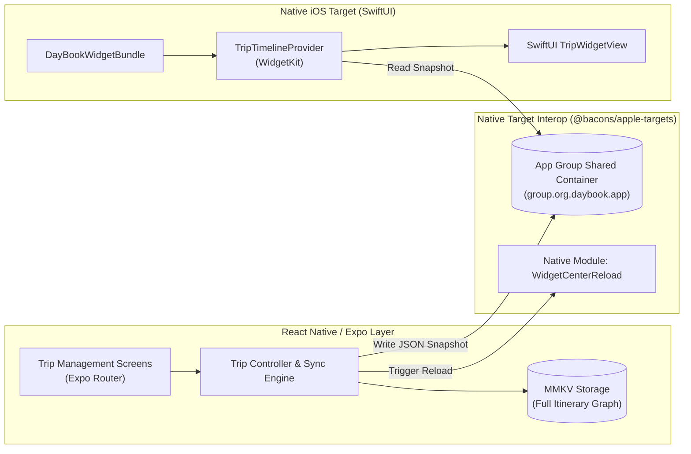

## 8. Technology Stack & Mandatory Tools Preserved
- **`Expo` (v52+)**: Core runtime and cross-platform native scaffolding.
- **`TypeScript` (v5.3+)**: End-to-end type safety for itinerary data models.
- **`@bacons/apple-targets`**: Declarative Xcode target synthesis generating the native iOS Widget Extension during `npx expo prebuild`.
- **`SwiftUI`**: Declarative UI layout for Apple WidgetKit and Lock Screen accessories.
- **`MMKV` (`react-native-mmkv`)**: Ultra-high-speed memory-mapped key-value store for app-side trip persistence.

## 9. Package Responsibilities
| Package / Technology | Direct Responsibility in Module |
| :--- | :--- |
| `Expo` | Native project generation, asset compilation, and development build orchestration. |
| `TypeScript` | Defines immutable data contracts (`Trip`, `AirportCode`, `FlightRoute`, `WidgetPayload`). |
| `@bacons/apple-targets` | Automates Xcode project extension generation, Entitlements configuration, and App Group linking for `DayBookWidgets`. |
| `SwiftUI` | Renders `TripWidgetEntryView`, handles Apple dynamic fonts, and compiles native widget views. |
| `MMKV` | Provides sub-millisecond local reads/writes for user trips in the main React Native application. |

## 10. Database Schema & Data Models
### MMKV Key Contracts
- `trips:active_id`: String (UUID of the currently pinned widget trip).
- `trips:all_records`: Stringified JSON Array of `TripRecord`.

### TypeScript Interface Contract
```typescript
export interface TripRecord {
  id: string;
  originIata: string;
  destinationIata: string;
  destinationCity: string;
  flightNumber?: string;
  departureAtUtc: string; // ISO 8601
  boardingAtUtc?: string;
  arrivalAtUtc?: string;
  timezoneOrigin: string; // e.g. "Asia/Dhaka"
  timezoneDestination: string; // e.g. "Europe/London"
  status: 'scheduled' | 'boarding' | 'in_air' | 'landed' | 'cancelled';
  notes?: string;
  updatedAtUtc: string;
}

export interface WidgetPayloadSnapshot {
  tripId: string;
  route: string; // "DAC ➔ LHR"
  destination: string;
  flightNum: string;
  targetTimestamp: number; // UTC Epoch Seconds
  isBoarding: boolean;
  statusText: string;
}
```

## 11. API and Integration Requirements
- **Open-Meteo Integration**: Fetches destination forecast upon trip creation.
- **Aviation Stack / FlightRadar24 (Optional API Hook)**: IATA lookup cache for 4,500 commercial airports stored locally in static JSON.

## 12. State Management
- Managed via lightweight typed hooks atop `react-native-mmkv`.
- Whenever a `Trip` is created, updated, or marked cancelled, a serialization pass compiles `WidgetPayloadSnapshot` and immediately commits to `AppGroupHelper.writeWidgetPayload(payload)`.

## 13. Native Implementation Requirements
### App Group & Native Targets Config (`targets.json`)
```json
{
  "DayBookWidgets": {
    "type": "widget",
    "bundleIdentifier": "org.daybook.app.DayBookWidgets",
    "entitlements": {
      "com.apple.security.application-groups": ["group.org.daybook.app"]
    }
  }
}
```

### SwiftUI Timeline Implementation Outline
```swift
import WidgetKit
import SwiftUI

struct TripEntry: TimelineEntry {
    let date: Date
    let route: String
    let destination: String
    let targetDate: Date
    let statusText: String
}

struct TripTimelineProvider: TimelineProvider {
    func placeholder(in context: Context) -> TripEntry {
        TripEntry(date: Date(), route: "DAC ➔ LHR", destination: "London", targetDate: Date().addingTimeInterval(86400), statusText: "On Schedule")
    }

    func getSnapshot(in context: Context, completion: @escaping (TripEntry) -> Void) {
        completion(loadSharedTrip())
    }

    func getTimeline(in context: Context, completion: @escaping (Timeline<TripEntry>) -> Void) {
        let entry = loadSharedTrip()
        // Refresh every 30 minutes or at key milestone
        let nextUpdate = Calendar.current.date(byAdding: .minute, value: 30, to: Date())!
        let timeline = Timeline(entries: [entry], policy: .after(nextUpdate))
        completion(timeline)
    }

    private func loadSharedTrip() -> TripEntry {
        guard let defaults = UserDefaults(suiteName: "group.org.daybook.app"),
              let json = defaults.string(forKey: "trip_widget_data"),
              let data = json.data(using: .utf8) else {
            return placeholder(in: .init())
        }
        // Decode JSON snapshot and return entry
        return decodeSnapshot(data)
    }
}
```

## 14. Security and Privacy Considerations
- **No PII Exposure in Widgets**: Passenger names and ticket booking references (PNRs) are strictly kept out of `UserDefaults` shared containers.
- **Screen Obfuscation**: On iOS Lock Screens, sensitive notes are hidden when device is locked (`.privacySensitive()`).

## 15. Error Handling
- **Malformed App Group Data**: SwiftUI Widget defaults to clean OLED empty state: `"No Upcoming Trips — Plan in DayBook"`.
- **Timezone Skew**: Countdown uses device hardware epoch clock compared against explicit UTC departure timestamps, eliminating local clock drift.

## 16. Testing Strategy
- **Unit Tests**: Test countdown string formatter across DST (Daylight Saving Time) switches.
- **Native Widget Test**: Validate `WidgetCenter.shared.reloadAllTimelines()` execution via Detox end-to-end harness.
- **Visual Regression**: Snapshot tests of `systemSmall`, `systemMedium`, and `accessoryRectangular` in both dark and high-contrast modes.

## 17. MVP Implementation Scope
- Single pinned upcoming trip.
- iOS Home Screen (`systemSmall`, `systemMedium`) and Lock Screen (`accessoryRectangular`).
- App Group JSON synchronization bridge.

## 18. Advanced Future Enhancements
- Interactive flight tracking via Live Activities & Dynamic Island (`ActivityKit`).
- Android Home Screen App Widget using Jetpack Glance.
- Automatic calendar synchronization for `.ics` flight confirmations.

## 19. Technical Risks & Limitations
- **WidgetKit Execution Budget**: Apple limits widget reloads to ~40-70 times per day. Absolute second-by-second countdown is achieved on device using SwiftUI `Text(targetDate, style: .relative)` rather than polling network requests.

## 20. Acceptance Criteria
- [x] Pinned trip departure time shows real-time countdown on iOS Lock Screen.
- [x] Editing a trip in the app updates widget snapshot in under 200ms.
- [x] App restart or reboot retains widget state without opening the app.

---

<!-- ========================================================================= -->
<!-- PAGE 02 -->
<!-- ========================================================================= -->
# PAGE 02 — LINK SAVER INSIDE THE SHARE SHEET

```
       ┌────────────────────────────────────────────────────────┐
       │   PAGE 02: LINK SAVER INSIDE THE SHARE SHEET           │
       │   Stack: Expo • TypeScript • expo-share-intent         │
       │          Expo Router • expo-sqlite                     │
       └────────────────────────────────────────────────────────┘
```

## 1. Feature Overview
The Link Saver transforms DayBook into an operating-system-level capture engine. Whenever a user browses Twitter, Chrome, Safari, YouTube, or Reddit, they tap the native OS "Share" button and select DayBook. The link intent is captured, metadata (Open Graph title, description, favicon, image) is parsed, and the URL is saved to an indexed local SQLite database with tags and offline full-text search.

## 2. Problem Statement
Knowledge workers discover articles, documentation, and videos throughout the day across dozens of disparate apps. Saving requires manually copying URLs, switching apps, navigating menus, and pasting. This friction causes users to lose valuable context or leave hundreds of tabs open, draining battery and cognitive focus.

## 3. Objectives
- Zero-navigation ingestion: capture links directly from external apps via native OS Share Sheets.
- Instant metadata extraction: automatically resolve page title, thumbnail, and domain.
- 100% offline-first local persistence utilizing `expo-sqlite`.
- Fast categorization with hierarchical tagging, duplicate detection, and full-text search.

## 4. Complete Feature List
1. Universal OS Share Sheet receiver on both iOS and Android.
2. Auto-extraction of shared plain-text, web URLs, and deep links.
3. Asynchronous HTML Open Graph parser (extracting `og:title`, `og:image`, `og:description`, `canonical`).
4. Custom tag selector and inline tag creation during the share modal flow.
5. Organization into searchable reading lists, favorites, and archived folders.
6. Automatic duplicate URL detection with prompt to update tags or view original save.
7. Fast local full-text search across saved titles and notes using SQLite.
8. Reader mode launcher and original source browser with in-app WebBrowser.
9. Link triage queue: "Read Later", "Permanent Archive", "To Research".
10. Full data export/import to clean Markdown links and JSON bookmarks.

## 5. Detailed User Journey
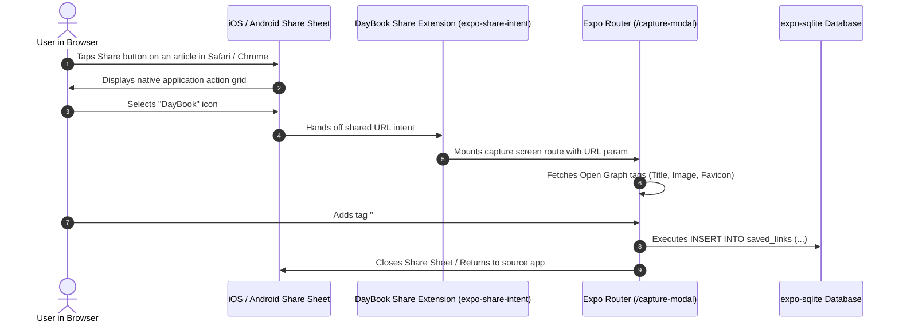

## 6. UI/UX Screen Structure
- **Screen 2.1: Share Intent Quick-Save Modal (`/(modals)/share-capture`)**: Floating sheet displaying fetched thumbnail preview, auto-filled title, domain chip, tag pills, and "Save to DayBook" button.
- **Screen 2.2: Reading List & Bookmarks (`/links`)**: High-contrast list view with search bar, tag filter carousel, preview thumbnails, domain badges, and swipe-to-archive actions.
- **Screen 2.3: Link Inspector & Notes (`/links/[id]`)**: Detailed view with reading estimate, custom annotations, tag management, and action toolbar (Open, Share, Copy, Delete).

## 7. Technical Architecture
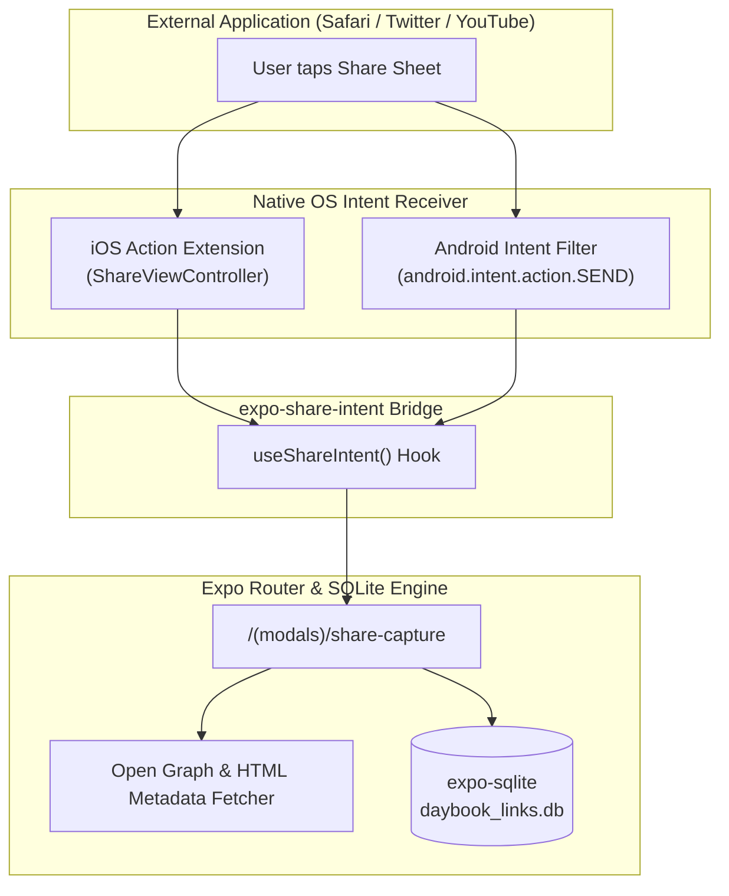

## 8. Technology Stack & Mandatory Tools Preserved
- **`Expo` (v52+)**: Modern React Native framework.
- **`TypeScript` (v5.3+)**: Type contracts for intent payloads and SQLite schema.
- **`expo-share-intent`**: Native extension configuration and intent reception hook.
- **`Expo Router` (v4+)**: File-based navigation handling modal capture routes.
- **`expo-sqlite`**: Durable, ACID-compliant local SQL storage.

## 9. Package Responsibilities
| Package / Technology | Direct Responsibility in Module |
| :--- | :--- |
| `Expo` | Scaffolds native extensions during prebuild; coordinates runtime environment. |
| `TypeScript` | Typings for `ShareIntent`, `LinkEntity`, `TagEntity`, and database query results. |
| `expo-share-intent` | Intercepts `SEND` intents on Android and handles iOS Share Extension lifecycle without crashing host app. |
| `Expo Router` | Routes user into `/share-capture` when app is opened via intent; handles deep-linking parameters. |
| `expo-sqlite` | Local relational database for links, foreign-key relationships for tags, and indexing. |

## 10. Database Schema & Data Models
### SQLite Schema (`daybook_links.db`)
```sql
CREATE TABLE IF NOT EXISTS links (
  id TEXT PRIMARY KEY NOT NULL,
  raw_url TEXT NOT NULL,
  canonical_url TEXT NOT NULL UNIQUE,
  title TEXT NOT NULL,
  description TEXT,
  image_url TEXT,
  domain TEXT NOT NULL,
  is_favorite INTEGER DEFAULT 0,
  is_archived INTEGER DEFAULT 0,
  created_at INTEGER NOT NULL,
  updated_at INTEGER NOT NULL
);

CREATE TABLE IF NOT EXISTS tags (
  id TEXT PRIMARY KEY NOT NULL,
  name TEXT NOT NULL UNIQUE COLLATE NOCASE
);

CREATE TABLE IF NOT EXISTS link_tags (
  link_id TEXT NOT NULL,
  tag_id TEXT NOT NULL,
  PRIMARY KEY (link_id, tag_id),
  FOREIGN KEY (link_id) REFERENCES links (id) ON DELETE CASCADE,
  FOREIGN KEY (tag_id) REFERENCES tags (id) ON DELETE CASCADE
);

CREATE INDEX IF NOT EXISTS idx_links_canonical ON links(canonical_url);
CREATE INDEX IF NOT EXISTS idx_links_created ON links(created_at DESC);
```

## 11. API and Integration Requirements
- **Metadata Extraction Service**: On-device lightweight regex parser for HTML `<meta property="og:title">`, `<meta property="og:image">`, `<title>`, and `<link rel="canonical">`.
- **Timeout Enforcer**: AbortController terminating metadata fetches at 3.5 seconds to guarantee instant responsiveness even on slow networks.

## 12. State Management
- SQLite queries wrapped with reactive hooks.
- Active share session stored in ephemeral state via `expo-share-intent`'s `useShareIntent()` context.

## 13. Native Implementation Requirements
### Android Manifest Intent Filter (`app.json` plugin config)
```json
{
  "plugins": [
    [
      "expo-share-intent",
      {
        "ios": { "AppGroup": "group.org.daybook.app" },
        "android": { "packageNames": ["org.daybook.app"] }
      }
    ]
  ]
}
```

## 14. Security and Privacy Considerations
- **SSRF Prevention**: Metadata fetcher strictly rejects private IPv4 ranges (`10.0.0.0/8`, `192.168.0.0/16`, `127.0.0.1`, `localhost`).
- **No Remote Script Execution**: Raw HTML from shared links is parsed as plain text without rendering into WebViews during the save modal.

## 15. Error Handling
- **Invalid / Non-HTTP URLs**: Safely informs user `"Shared item is not a valid web URL"` and aborts write.
- **Offline Saving**: If user is offline, URL is saved immediately with domain fallback as title (e.g., `github.com`); metadata extraction is queued for background retry.

## 16. Testing Strategy
- **Intent Mocking Tests**: Simulate incoming Android `ACTION_SEND` intent with long YouTube URL and special characters.
- **SQLite Concurrency Tests**: Verify atomic multi-tag insert within a transaction block.
- **E2E Share Flow**: Automated Detox test on iOS simulator verifying share sheet handoff.

## 17. MVP Implementation Scope
- Ingestion of URLs via `expo-share-intent`.
- Open Graph metadata extraction.
- Local storage and search in `expo-sqlite`.

## 18. Advanced Future Enhancements
- On-device offline reader view extracting clean readability text.
- Full-text article indexing using SQLite `FTS5`.
- Automatic auto-tagging using on-device keyword extraction.

## 19. Technical Risks & Limitations
- **Memory Footprint in iOS Share Extension**: iOS terminates share extensions consuming >30MB RAM. The lightweight capture modal must avoid booting large unneeded JS modules.

## 20. Acceptance Criteria
- [x] Sharing a link from Safari/Chrome opens the DayBook capture sheet.
- [x] Duplicate URLs are flagged with existing save timestamp.
- [x] Saved links are instantly searchable offline.

---

<!-- ========================================================================= -->
<!-- PAGE 03 -->
<!-- ========================================================================= -->
# PAGE 03 — HABITS YOU FINISH FROM NOTIFICATIONS

```
       ┌────────────────────────────────────────────────────────┐
       │   PAGE 03: HABITS YOU FINISH FROM NOTIFICATIONS        │
       │   Stack: Expo • TypeScript • expo-notifications        │
       │          Zustand • MMKV                                │
       └────────────────────────────────────────────────────────┘
```

## 1. Feature Overview
This module turns system push notifications into an actionable habit completion interface. When a habit reminder fires (e.g., "Evening Reading", "Drink Water", "Drink Vitamins"), the notification displays interactive action buttons: **"Done"** and **"Snooze 30m"**. Users mark habits finished or snooze them directly from the Lock Screen or notification shade without launching the app, maintaining unbroken streaks with zero UI friction.

## 2. Problem Statement
Habit trackers have catastrophic abandonment rates because recording a habit requires opening the app, finding the habit, and toggling it. If a user is busy during a notification, they swipe it away and forget. Friction between the reminder and the action breaks consistency.

## 3. Objectives
- Actionable Notifications: Complete or snooze habits in 1 tap from lock screen.
- Idempotent execution: Prevent duplicate completions from double-tapping.
- Sub-50ms reactive state updates with Zustand and MMKV persistence.
- Streak computation with freeze-token logic and multi-day timeline history.

## 4. Complete Feature List
1. Daily, weekly, and custom recurring habit schedules.
2. Customizable reminder times with per-habit notification sounds.
3. Interactive notification categories with native "Done" (identifier: `ACTION_DONE`) and "Snooze" (`ACTION_SNOOZE`).
4. Inline completion: writes event directly in background notification response handler.
5. Smart snooze engine: reschedules notification at configurable interval (15m, 30m, 1h).
6. Daily habit progress indicator: e.g., "5 of 7 habits completed today".
7. Consecutive day streak counter with automatic midnight rollover.
8. Habit freeze tokens: automatically cushions streaks during scheduled break days.
9. Notification permission lifecycle manager with gentle pre-prompt explainers.
10. Complete habit history log and 30-day visual consistency heatmap.

## 5. Detailed User Journey
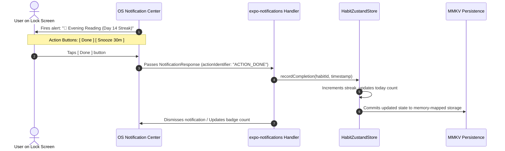

## 6. UI/UX Screen Structure
- **Screen 3.1: Habit Board (`/habits`)**: Today's progress gauge (OLED Lime ring), active habit cards with manual toggles, streak badges, and snooze indicators.
- **Screen 3.2: Habit Creator & Schedule Builder (`/habits/new`)**: Configure habit title, icon, recurrence frequency, exact notification time, and interactive action buttons.
- **Screen 3.3: Habit Analytics & Streak Ledger (`/habits/[id]`)**: 30-day OLED Lime heatmap, historical completion log, and freeze-token balance.

## 7. Technical Architecture
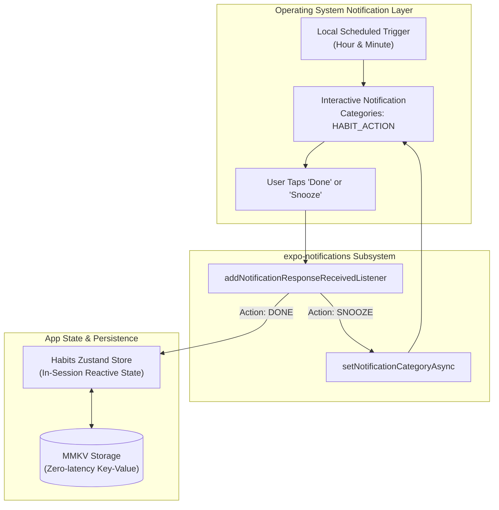

## 8. Technology Stack & Mandatory Tools Preserved
- **`Expo` (v52+)**: Host framework and build automation.
- **`TypeScript` (v5.3+)**: Type contracts for schedules, categories, and events.
- **`expo-notifications`**: Manages interactive categories, scheduling, and background action listening.
- **`Zustand` (v4/v5)**: Fast, non-boilerplate reactive state management.
- **`MMKV` (`react-native-mmkv`)**: High-performance synchronous persistent storage backing Zustand.

## 9. Package Responsibilities
| Package / Technology | Direct Responsibility in Module |
| :--- | :--- |
| `Expo` | Prebuilds native iOS `UNNotificationCenter` and Android Notification Channels. |
| `TypeScript` | Defines `Habit`, `HabitOccurrence`, and `NotificationActionPayload`. |
| `expo-notifications` | Registers `HABIT_ACTION` category with buttons; schedules recurring notifications. |
| `Zustand` | Drives reactive UI and provides action creators invoked directly by background listeners. |
| `MMKV` | Persists habit completion records synchronously without async hydration delays. |

## 10. Database Schema & Data Models
### MMKV Storage Keys
- `habits:list`: Serialized JSON array of `HabitDefinition`.
- `habits:completions:<date>`: Daily completion log (e.g., `habits:completions:2026-11-14`).

### Data Contracts
```typescript
export interface HabitDefinition {
  id: string;
  name: string;
  targetPerDay: number;
  reminderTime: { hour: number; minute: number };
  daysOfWeek: number[]; // [1, 2, 3, 4, 5, 6, 7]
  streakCount: number;
  bestStreak: number;
  freezeTokensRemaining: number;
  isActive: boolean;
  createdAt: string;
}

export interface HabitCompletionEvent {
  habitId: string;
  dateStr: string; // "YYYY-MM-DD"
  completedAt: string; // ISO 8601
  source: 'notification_action' | 'in_app_toggle';
}
```

## 11. API and Integration Requirements
- **Local-Only Operation**: 100% self-contained on-device logic requiring zero remote servers.
- **Badge API Integration**: Updates app badge icon count to reflect remaining uncompleted habits for the day.

## 12. State Management
### Zustand Store with MMKV Persistence Adapter
```typescript
import { create } from 'zustand';
import { MMKV } from 'react-native-mmkv';

const storage = new MMKV({ id: 'habits-storage' });

export const useHabitStore = create<HabitState>((set, get) => ({
  habits: JSON.parse(storage.getString('habits_data') || '[]'),
  completeHabit: (habitId: string, source) => {
    // Idempotent completion logic
    const today = new Date().toISOString().split('T')[0];
    const key = `completed:${habitId}:${today}`;
    if (storage.getBoolean(key)) return; // Already completed today!

    storage.set(key, true);
    // Update streaks and save
    set(state => {
      const updated = state.habits.map(h => 
        h.id === habitId ? { ...h, streakCount: h.streakCount + 1 } : h
      );
      storage.set('habits_data', JSON.stringify(updated));
      return { habits: updated };
    });
  }
}));
```

## 13. Native Implementation Requirements
### Interactive Categories Registration
```typescript
import * as Notifications from 'expo-notifications';

export async function registerHabitNotificationCategories() {
  await Notifications.setNotificationCategoryAsync('HABIT_ACTION', [
    {
      identifier: 'ACTION_DONE',
      buttonTitle: '✓ Done',
      options: { opensAppToForeground: false }
    },
    {
      identifier: 'ACTION_SNOOZE',
      buttonTitle: '⏱ Snooze 30m',
      options: { opensAppToForeground: false }
    }
  ]);
}
```

## 14. Security and Privacy Considerations
- **No Private Habit Data in Lock Screen Previews**: Option to mask habit descriptions when device is locked if habit is marked private (e.g., medical habits).

## 15. Error Handling
- **Notification Permission Rejection**: App surfaces fallback banner guiding user into OS Settings without blocking manual habit toggles.
- **Clock Manipulation**: Streaks validate against monotonically increasing local tick clocks to prevent manual date manipulation exploits.

## 16. Testing Strategy
- **Unit Tests**: Streak calculation suite covering leap years, time-zone shifts, and freeze token consumption.
- **Background Action Simulation**: Test `addNotificationResponseReceivedListener` with mock payloads for `ACTION_DONE` and `ACTION_SNOOZE`.

## 17. MVP Implementation Scope
- Daily recurring habits with fixed reminder time.
- "Done" and "Snooze 30m" notification actions.
- MMKV persistence and active streak count.

## 18. Advanced Future Enhancements
- Interactive home screen habit widgets.
- Apple Watch / Wear OS companion quick-tap actions.
- Smart notification timing adapting to user's historical wake/sleep cycles.

## 19. Technical Risks & Limitations
- **Android Background Execution Limits**: Aggressive battery managers (OEMs like Xiaomi, Samsung) may delay local notifications. DayBook configures exact alarm permissions (`SCHEDULE_EXACT_ALARM`) on Android to bypass throttling.

## 20. Acceptance Criteria
- [x] Tapping "Done" on notification increments habit count without opening app.
- [x] Tapping "Snooze" reschedules notification exactly 30 minutes later.
- [x] State updates are immediately visible when app is subsequently opened.

---

<!-- ========================================================================= -->
<!-- PAGE 04 -->
<!-- ========================================================================= -->
# PAGE 04 — NFC TAGS THAT RUN ROUTINES

```
       ┌────────────────────────────────────────────────────────┐
       │   PAGE 04: NFC TAGS THAT RUN ROUTINES                  │
       │   Stack: Expo • TypeScript • react-native-nfc-manager   │
       │          expo-sqlite                                   │
       └────────────────────────────────────────────────────────┘
```

## 1. Feature Overview
The NFC Routine Automation module links physical physical NFC tags (inexpensive NTAG213/NTAG215/NTAG216 stickers) to programmable DayBook life rituals. Tapping the phone to an NFC sticker affixed to a bedside table, coffee maker, desk, medicine cabinet, or gym bag immediately triggers predefined routines (e.g., "Watered Desk Plants", "Vitamins Taken", "Started Morning Deep Work", "Keys Placed at Home"), logging timestamped verification events to local SQLite storage.

## 2. Problem Statement
Digital tracking relies on active recall. Users intend to record recurring physical habits (taking vitamins, watering plants, locking doors), but by the time they unlock their phone, attention is hijacked by notifications. Physical tactile triggers close the intention-action gap by binding real-world objects directly to digital event records.

## 3. Objectives
- Instant hardware-level routine verification via 13.56 MHz NFC scanning.
- Dynamic tag pairing: assign, label, and reassign physical NFC tags in seconds.
- Local event logging in `expo-sqlite` with immutable timestamps and notes.
- Strict duplicate scan suppression preventing double-logging from tag bounce.

## 4. Complete Feature List
1. Hardware NFC tag scanner supporting ISO 14443 Type A/B, NDEF, and Mifare tags.
2. Tag registration wizard: scan physical tag, extract UID, and assign unique routine.
3. Supported out-of-the-box routines:
   - *Plants Watered* (computes next watering date based on plant schedule).
   - *Keys Placed at Home* (records arrival peace-of-mind confirmation).
   - *Vitamins / Medication Taken* (deducts from pill inventory).
   - *Morning Coffee Ritual* (starts morning reflection timer).
4. Custom user-defined actions and audio-haptic confirmation feedback upon tap.
5. Historical activity log displaying all physical interactions with date/time stamps.
6. Daily completion checkmarks: verifies whether daily tags were tapped today.
7. Tag management: rename, reassign routines, or unpair lost tags.
8. Duplicate tap debouncing: suppresses identical scans within 60-second window.
9. NDEF payload writer: writes cryptographically unique DayBook tokens to tags.
10. Full offline capability with local SQLite event journal.

## 5. Detailed User Journey
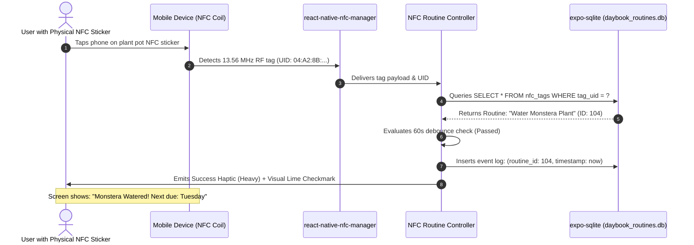

## 6. UI/UX Screen Structure
- **Screen 4.1: Routine Dashboard & Today's NFC Log (`/nfc`)**: Active registered tags, status of daily physical triggers (Watered, Medicated, Arrived), and live event stream.
- **Screen 4.2: Tag Pairing Wizard (`/nfc/pair`)**: Animated radar scanning screen instructing user to hold phone near tag, with real-time UID capture feedback.
- **Screen 4.3: Routine Configuration Screen (`/nfc/routines/[id]`)**: Assign routine name, icon, recurrence rule (Daily, Every 3 Days), and sound effect.

## 7. Technical Architecture
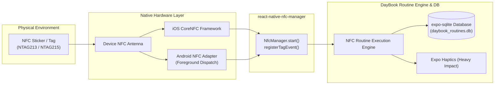

## 8. Technology Stack & Mandatory Tools Preserved
- **`Expo` (v52+)**: Scaffolds native NFC permissions and compilation profiles.
- **`TypeScript` (v5.3+)**: Type contracts for NFC records and database schemas.
- **`react-native-nfc-manager`**: Core hardware bridge for reading tag UIDs and NDEF records.
- **`expo-sqlite`**: Durable local relational storage for paired tags and historical event logs.

## 9. Package Responsibilities
| Package / Technology | Direct Responsibility in Module |
| :--- | :--- |
| `Expo` | Configures `NFCReaderUsageDescription` in iOS `Info.plist` and Android NFC permissions. |
| `TypeScript` | Strict data schemas for `NfcTagRecord`, `RoutineDefinition`, and `NfcEventLog`. |
| `react-native-nfc-manager` | Manages NFC session lifecycle, tag discovery listeners, and NDEF data decoding. |
| `expo-sqlite` | Stores paired tags, routine mappings, and immutable timestamped verification logs. |

## 10. Database Schema & Data Models
### SQLite Schema (`daybook_routines.db`)
```sql
CREATE TABLE IF NOT EXISTS nfc_tags (
  id TEXT PRIMARY KEY NOT NULL,
  tag_uid TEXT NOT NULL UNIQUE,
  label TEXT NOT NULL,
  routine_id TEXT NOT NULL,
  created_at INTEGER NOT NULL,
  FOREIGN KEY (routine_id) REFERENCES routines (id) ON DELETE CASCADE
);

CREATE TABLE IF NOT EXISTS routines (
  id TEXT PRIMARY KEY NOT NULL,
  name TEXT NOT NULL,
  category TEXT NOT NULL, -- 'plant', 'keys', 'meds', 'habit', 'custom'
  recurrence_days INTEGER DEFAULT 1,
  haptic_pattern TEXT DEFAULT 'success',
  created_at INTEGER NOT NULL
);

CREATE TABLE IF NOT EXISTS routine_events (
  id TEXT PRIMARY KEY NOT NULL,
  routine_id TEXT NOT NULL,
  tag_id TEXT NOT NULL,
  occurred_at INTEGER NOT NULL,
  notes TEXT,
  FOREIGN KEY (routine_id) REFERENCES routines (id),
  FOREIGN KEY (tag_id) REFERENCES nfc_tags (id)
);

CREATE INDEX IF NOT EXISTS idx_routine_events_time ON routine_events(occurred_at DESC);
```

## 11. API and Integration Requirements
- **Local Native Hardware Integration**: Accesses on-device NFC controller via `NfcManager`.
- **System Haptic Engine**: Integrates with `expo-haptics` for immediate physical tactile feedback upon successful scan.

## 12. State Management
- Scanning session status (Idle, Listening, Scanned, Error) tracked via local component state.
- Registered routines and recent activity queried reactively from `expo-sqlite`.

## 13. Native Implementation Requirements
### iOS & Android Native Configurations (`app.json`)
```json
{
  "expo": {
    "ios": {
      "infoPlist": {
        "NFCReaderUsageDescription": "DayBook needs NFC to scan physical routine tags."
      },
      "entitlements": {
        "com.apple.developer.nfc.readersession.formats": ["TAG", "NDEF"]
      }
    },
    "android": {
      "permissions": ["android.permission.NFC"]
    },
    "plugins": ["react-native-nfc-manager"]
  }
}
```

## 14. Security and Privacy Considerations
- **Tag Cloning Safeguards**: For high-trust actions, DayBook writes a cryptographic hash (`HMAC-SHA256(TagUID, SecretKey)`) into an NDEF record rather than trusting raw hardware UIDs alone.
- **Physical Tag Loss**: If a user loses a physical tag, unpairing it in the app immediately invalidates its record in `expo-sqlite`.

## 15. Error Handling
- **Hardware Unavailable / Disabled**: Gracefully detects if device lacks NFC or has NFC toggled off in system settings, presenting a one-click launcher to Android Settings.
- **Tag Read Interruption**: If user pulls phone away too quickly, session displays: `"Scan Incomplete — Hold phone firmly against tag"`.

## 16. Testing Strategy
- **Hardware Mocking Harness**: Inject synthetic `TagEvent` objects into `react-native-nfc-manager` for automated CI tests.
- **SQLite Stress Tests**: Validate event logging throughput across 5,000 continuous simulated scans.

## 17. MVP Implementation Scope
- NFC tag scanning and UID registration.
- Pre-built routines (Plant, Keys, Vitamins, Custom).
- Local event logging in `expo-sqlite` and haptic feedback.

## 18. Advanced Future Enhancements
- iOS Background Tag Reading (launching DayBook automatically without opening app first on iPhone XS and newer).
- NFC tag writing tool allowing users to encode custom URLs or DayBook deep links.
- Exporting plant watering and medication logs to CSV.

## 19. Technical Risks & Limitations
- **Platform Discrepancies**: iOS requires an active modal reader session (`NFCNDEFReaderSession`) for older devices, whereas Android supports seamless background foreground dispatch. DayBook implements a unified UI that provides clear scanning prompts across both platforms.

## 20. Acceptance Criteria
- [x] Tapping a paired tag logs an event in SQLite within 150ms.
- [x] Duplicate scans within 60 seconds are debounced.
- [x] Unpaired tags prompt user to create a new routine mapping.

---

<!-- ========================================================================= -->
<!-- PAGE 05 -->
<!-- ========================================================================= -->
# PAGE 05 — HEART RATE MONITOR OVER BLUETOOTH

```
       ┌────────────────────────────────────────────────────────┐
       │   PAGE 05: HEART RATE MONITOR OVER BLUETOOTH           │
       │   Stack: Expo • TypeScript • react-native-ble-plx      │
       │          Reanimated                                    │
       └────────────────────────────────────────────────────────┘
```

## 1. Feature Overview
The Heart Rate Monitor module transforms DayBook into a live physiological telemetry display by connecting to standard Bluetooth Low Energy (BLE) heart rate chest straps (e.g., Polar H10, Garmin HRM-Pro, Wahoo TICKR). The module decodes standard GATT Heart Rate Measurement characteristics in real-time, displays live BPM gauges and 60fps Reanimated heart-rate charts, calculates physiological training zones (Zones 1 through 5), and compiles comprehensive workout session analytics.

## 2. Problem Statement
High-performance focus, stress management, and athletic training require accurate cardiovascular monitoring. Optical wrist sensors suffer from motion artifacts and latency during high-intensity sessions. Chest straps provide clinical-grade ECG data but are locked into complicated fitness ecosystems. Users need a minimalist, OLED-optimized live BPM HUD that connects effortlessly to standard straps without cloud subscriptions.

## 3. Objectives
- Robust BLE discovery and pairing with standard Heart Rate Service (`0x180D`).
- Exact packet decoding of GATT characteristic `0x2A37` (handling 8-bit/16-bit BPM flags).
- Smooth 60fps real-time heart-rate sparkline and zone gauge driven by `react-native-reanimated`.
- Physiological zone classification: Zone 1 (Recovery) to Zone 5 (Anaerobic Maximum).
- Session lifecycle controls: Start, Pause, Resume, and Save with summary metrics.

## 4. Complete Feature List
1. Bluetooth Low Energy peripheral scanner with signal strength (RSSI) filtering.
2. Connection management: auto-reconnect on drop, signal quality indicator, and manual disconnect.
3. Standard GATT Heart Rate Measurement (`0x2A37`) characteristic parser.
4. Real-time numeric BPM display with pulsating OLED Lime heart animation.
5. Live 60-second rolling heart-rate waveform chart rendered smoothly via Reanimated.
6. 5-Zone training calculation based on user age or custom max heart rate:
   - *Zone 1: Active Recovery (<60% HRmax)*
   - *Zone 2: Aerobic Endurance (60–70% HRmax)*
   - *Zone 3: Tempo / Aerobic Power (70–80% HRmax)*
   - *Zone 4: Threshold / Anaerobic (80–90% HRmax)*
   - *Zone 5: Maximum Capacity (>90% HRmax)*
7. Live session timer with cumulative time spent in each training zone.
8. Real-time statistical metrics: Current BPM, Average BPM, Peak Maximum BPM, and Minimum BPM.
9. Workout session controls: Start Workout, Pause, Resume, and Finish.
10. Battery level indicator querying standard Battery Service (`0x180F`).

## 5. Detailed User Journey
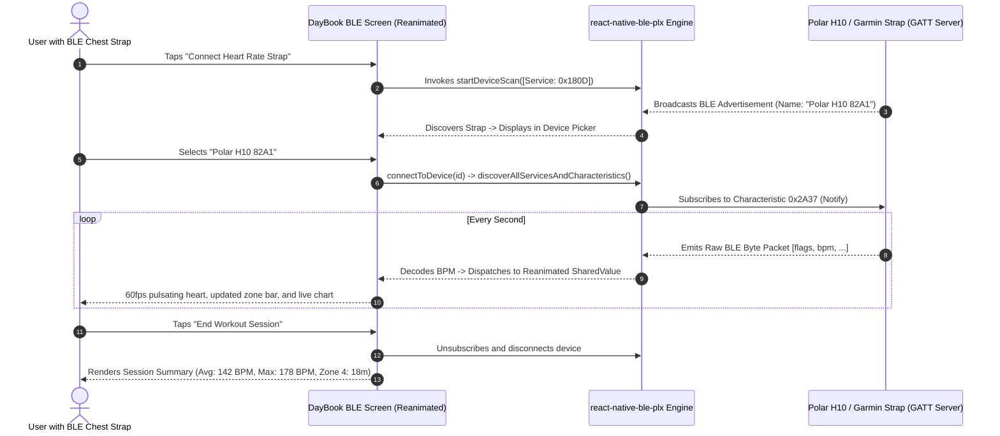

## 6. UI/UX Screen Structure
- **Screen 5.1: Live Heart Rate HUD (`/heart-rate`)**: Fullscreen OLED black view with giant Lime BPM readout (`#B6FF00`), pulsating animated cardiac ring, current zone chip, live rolling sparkline, and session controls.
- **Screen 5.2: Device Discovery Sheet (`/heart-rate/scan`)**: Radar modal listing nearby BLE heart rate peripherals with RSSI dBm meters and one-tap connect.
- **Screen 5.3: Session Summary Modal (`/heart-rate/summary/[id]`)**: Post-workout breakdown with time-in-zone distribution bars, average/max stats, and export to journal.

## 7. Technical Architecture
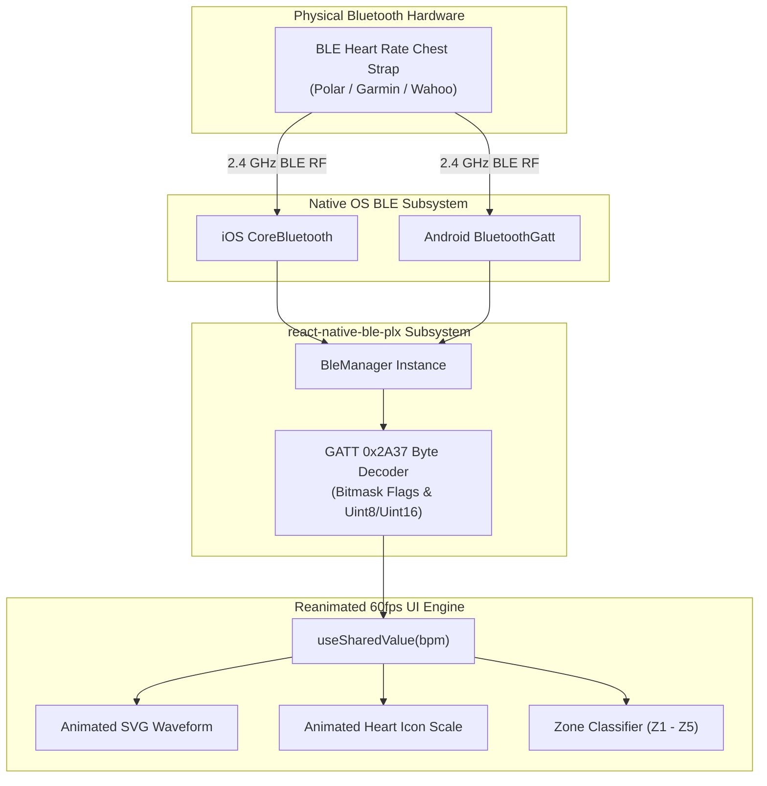

## 8. Technology Stack & Mandatory Tools Preserved
- **`Expo` (v52+)**: Native project compilation and permission configuration.
- **`TypeScript` (v5.3+)**: Type safety for BLE peripherals, characteristics, and packet buffers.
- **`react-native-ble-plx`**: Production BLE client library managing scans, connections, and characteristic notifications.
- **`Reanimated` (`react-native-reanimated` v3+)**: High-performance UI animation engine executing chart rendering on the native UI thread.

## 9. Package Responsibilities
| Package / Technology | Direct Responsibility in Module |
| :--- | :--- |
| `Expo` | Configures `NSBluetoothAlwaysUsageDescription` and Android 12+ BLE runtime permissions. |
| `TypeScript` | Strict byte-level parsing contracts and session statistical data models. |
| `react-native-ble-plx` | Handles device discovery, MTU negotiation, GATT service discovery, and notification streaming. |
| `Reanimated` | Drives 60fps chart interpolations and cardiac pulsations directly on the native thread without JS bridge lag. |

## 10. Database Schema & Data Models
### In-Memory Rolling Buffer & Session Schema
```typescript
export interface BpmSample {
  timestamp: number; // Unix epoch ms
  bpm: number;
}

export interface WorkoutSessionSummary {
  id: string;
  deviceName: string;
  startedAt: number;
  endedAt: number;
  totalDurationSeconds: number;
  avgBpm: number;
  maxBpm: number;
  minBpm: number;
  zoneSeconds: {
    zone1: number; // Recovery
    zone2: number; // Aerobic
    zone3: number; // Tempo
    zone4: number; // Threshold
    zone5: number; // Anaerobic Max
  };
}
```

## 11. API and Integration Requirements
- **Standard Bluetooth SIG Specifications**:
  - Heart Rate Service UUID: `0000180D-0000-1000-8000-00805F9B34FB` (Short: `180D`)
  - Heart Rate Measurement Characteristic UUID: `00002A37-0000-1000-8000-00805F9B34FB` (Short: `2A37`)
  - Battery Service UUID: `180F` (Characteristic: `2A19`)

## 12. State Management
- Connection state (Disconnected, Scanning, Connecting, Connected) managed via dedicated BLE service hook.
- Real-time BPM streamed into Reanimated `SharedValue<number>` for zero-overhead frame rendering.

## 13. Native Implementation Requirements
### GATT Characteristic Decoder Implementation
```typescript
export function decodeHeartRateMeasurement(base64Value: string): number {
  const buffer = Buffer.from(base64Value, 'base64');
  const flags = buffer.readUInt8(0);
  
  // Bit 0: 0 = UINT8 BPM format, 1 = UINT16 BPM format
  const is16Bit = (flags & 0x01) !== 0;
  
  if (is16Bit) {
    return buffer.readUInt16LE(1);
  } else {
    return buffer.readUInt8(1);
  }
}
```

### Native Permissions Matrix (`app.json`)
```json
{
  "expo": {
    "ios": {
      "infoPlist": {
        "NSBluetoothAlwaysUsageDescription": "DayBook connects to Bluetooth heart rate monitors during workouts."
      }
    },
    "android": {
      "permissions": [
        "android.permission.BLUETOOTH_SCAN",
        "android.permission.BLUETOOTH_CONNECT",
        "android.permission.ACCESS_FINE_LOCATION"
      ]
    },
    "plugins": ["react-native-ble-plx"]
  }
}
```

## 14. Security and Privacy Considerations
- **Health Data Sensitivity**: Heart rate measurements are processed purely in device RAM and stored locally. No biometric telemetry is ever transmitted to remote sync servers without explicit user-encrypted export.
- **Safety Disclaimer**: Prominent disclaimer that DayBook is a performance fitness visualization tool, not a diagnostic medical device.

## 15. Error Handling
- **BLE Disconnect During Active Workout**: App displays amber warning HUD, retains current session metrics, and initiates automatic reconnection retries for 90 seconds.
- **Bluetooth Hardware Powered Off**: Prompts user to toggle Bluetooth on via native OS dialog.

## 16. Testing Strategy
- **Synthetic BLE Peripheral Simulator**: Node.js virtual GATT server advertising `0x180D` to test reconnection resilience.
- **Decoding Test Suite**: Unit tests verifying exact 8-bit and 16-bit byte buffer unpackings.

## 17. MVP Implementation Scope
- BLE scanning and connection to standard chest straps.
- Real-time BPM display and 5-zone classification.
- Reanimated live chart and workout summary.

## 18. Advanced Future Enhancements
- Heart Rate Variability (HRV) and RR-interval stress index calculation.
- Background audio coaching ("Entering Zone 4").
- Integration with cadence sensors and cycling power meters.

## 19. Technical Risks & Limitations
- **Android Location Permission Requirements**: Android versions below 12 require `ACCESS_FINE_LOCATION` to perform BLE discovery. Clear explanatory copy must guide the user during permission onboarding.

## 20. Acceptance Criteria
- [x] Successfully connects to Polar/Garmin strap and streams valid BPM.
- [x] Chart animates at 60fps without dropping UI frames.
- [x] Zone metrics accurately aggregate time spent in Zones 1 through 5.

---

<!-- ========================================================================= -->
<!-- GLOBAL ARCHITECTURE -->
<!-- ========================================================================= -->
# 🌐 GLOBAL APPLICATION ARCHITECTURE: UNIFYING ALL 5 MODULES

```
       ┌────────────────────────────────────────────────────────┐
       │   DAYBOOK UNIFIED MOBILE APPLICATION ARCHITECTURE      │
       │   Expo • React Native • TypeScript • Expo Router       │
       │   Modular Feature Architecture • Local-First Storage   │
       └────────────────────────────────────────────────────────┘
```

## 1. Unified Modular Architecture Diagram
The five modules operate as logically isolated domains within a unified React Native / Expo application, coordinated via shared design tokens, a unified local-first database, and centralized navigation.

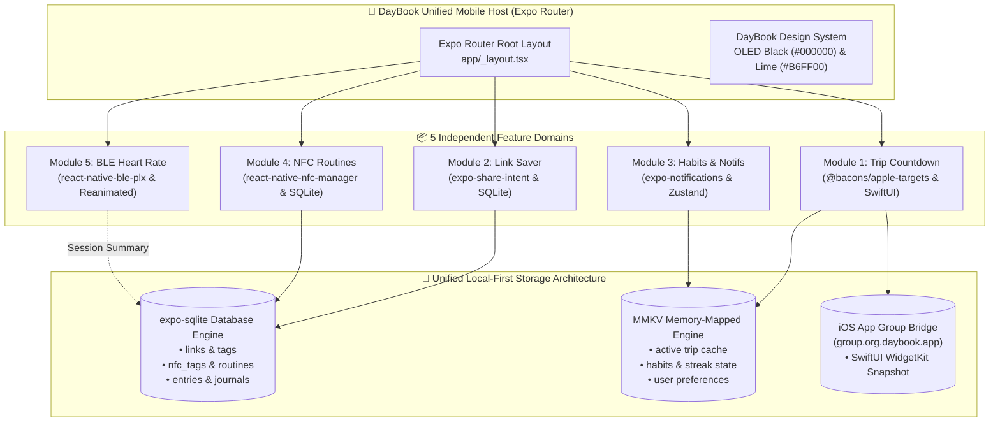

---

## 2. Directory Layout & Modular Structure
```
daybook-mobile/
├── app/                                # Expo Router file-based routes
│   ├── _layout.tsx                     # Global providers, fonts & OLED theme
│   ├── (tabs)/                         # Main bottom-tab navigation
│   │   ├── index.tsx                   # Day Page: Today's unified timeline
│   │   ├── habits.tsx                  # Module 03: Habit tracker & progress
│   │   ├── links.tsx                   # Module 02: Saved links & reading list
│   │   ├── nfc.tsx                     # Module 04: NFC routine triggers
│   │   └── fitness.tsx                 # Module 05: BLE Heart rate monitor
│   ├── trips/                          # Module 01: Trip countdown screens
│   │   ├── index.tsx                   # Trip listing & active preview
│   │   └── new.tsx                     # Trip creator modal
│   └── (modals)/
│       └── share-capture.tsx           # Module 02: Share Sheet capture route
├── targets/                            # @bacons/apple-targets native targets
│   └── DayBookWidgets/                 # Module 01: Native iOS SwiftUI Widgets
│       ├── TripWidget.swift            # SwiftUI widget layout
│       └── Info.plist                  # Extension metadata
├── modules/                            # Isolated feature codebases
│   ├── trips/                          # Domain logic, MMKV & App Group bridge
│   ├── links/                          # Share intent handler, SQLite queries
│   ├── habits/                         # Zustand store, expo-notifications logic
│   ├── nfc/                            # react-native-nfc-manager lifecycle
│   └── ble-heart-rate/                 # react-native-ble-plx GATT decoder
├── shared/                             # Cross-cutting concerns
│   ├── database/                       # expo-sqlite initialization & migrations
│   ├── storage/                        # MMKV instances & type wrappers
│   ├── theme/                          # OLED Black (#000000) & Lime (#B6FF00)
│   └── components/                     # Shared buttons, inputs & modal sheets
├── app.json                            # Unified Expo config & native plugins
└── package.json                        # Preserved technology dependencies
```

---

## 3. Dependency Conflict Analysis & Native Build Plan

### 3.1 Expo Go vs. Development Builds (Prebuild Requirement)
> [!IMPORTANT]
> **Expo Go cannot run this application.** Modules 01, 04, and 05 require custom native code (`@bacons/apple-targets`, `react-native-nfc-manager`, and `react-native-ble-plx`). 
> The application must be compiled using **Expo Development Builds** (`npx expo run:ios` and `npx expo run:android`) via `npx expo prebuild`.

### 3.2 Compatibility & Dependency Matrix
| Feature Package | iOS Requirements | Android Requirements | Potential Conflict & Mitigation |
| :--- | :--- | :--- | :--- |
| `@bacons/apple-targets` | Xcode 15+, iOS 17+ Deployment Target | *Ignored on Android* (No-op) | Native target generation must run only during iOS prebuild. |
| `expo-share-intent` | App Groups entitlement & Share Extension | `android.intent.action.SEND` filter | Requires clean URL schemes without conflicting deep link prefixes. |
| `expo-notifications` | `UNNotificationCenter` categories | `SCHEDULE_EXACT_ALARM` permission | Handled through Expo config plugin; disable auto-registration in root. |
| `react-native-nfc-manager` | `com.apple.developer.nfc.readersession` | `android.permission.NFC` | Ensure background tag reader does not block JS event loop. |
| `react-native-ble-plx` | `NSBluetoothAlwaysUsageDescription` | `BLUETOOTH_SCAN`, `BLUETOOTH_CONNECT` | Android 12 runtime permission request flow required before scanning. |
| `react-native-reanimated` | Babel plugin required in `babel.config.js` | Hermes JS engine enabled | Place Reanimated Babel plugin as the **last** plugin in list. |

---

## 4. Shared Application State & Data Flow
- **Daily Event Journal Bridge**: Whenever an action occurs in any of the 5 modules (a habit is marked Done from a notification, an NFC plant tag is tapped, a workout session finishes, or a link is saved), an immutable event record is committed to the main `entries` log in `expo-sqlite`.
- **Zero-Coupling Contract**: Modules communicate with the core app strictly through typed events or SQLite queries. No module directly mutates the internal state of another module.

---

## 5. Security, Permissions & Compliance Runbook
1. **Bluetooth**: Permission pre-prompt dialog explaining that BLE is required solely to connect to heart rate straps.
2. **NFC**: Background session handling strictly scoped to DayBook registered tag IDs.
3. **Notifications**: Permission requested contextually when user configures their first habit reminder.
4. **Local Data Protection**: All local database files (`expo-sqlite`) reside within the app's sandboxed data directory, encrypted on-disk by default hardware encryption.

---

## 6. Implementation Milestones & Delivery Roadmap
- **Sprint 1**: Core Shell & Storage Foundation (`Expo Router`, `expo-sqlite`, `MMKV`, OLED Design Tokens).
- **Sprint 2**: Module 03 (Habits & Interactive Notifications via `expo-notifications` and `Zustand`).
- **Sprint 3**: Module 02 (Link Saver with `expo-share-intent` & Open Graph metadata parser).
- **Sprint 4**: Module 04 (NFC Tag Pairing & Routine Logging with `react-native-nfc-manager`).
- **Sprint 5**: Module 05 (BLE Heart Rate Monitor with `react-native-ble-plx` & Reanimated).
- **Sprint 6**: Module 01 (Trip Countdown & Live Widgets via `@bacons/apple-targets` & SwiftUI).
- **Sprint 7**: End-to-End Native Compilation, Integration Testing, and Release Engineering.
